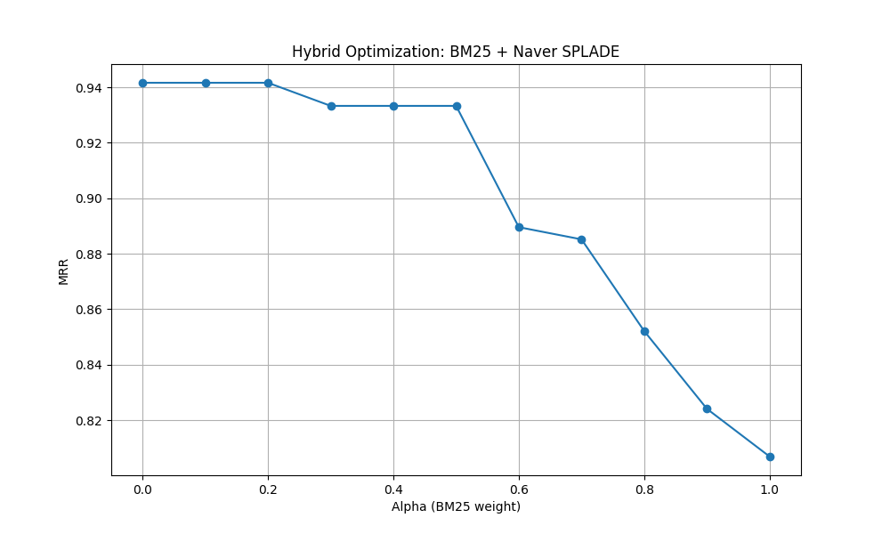
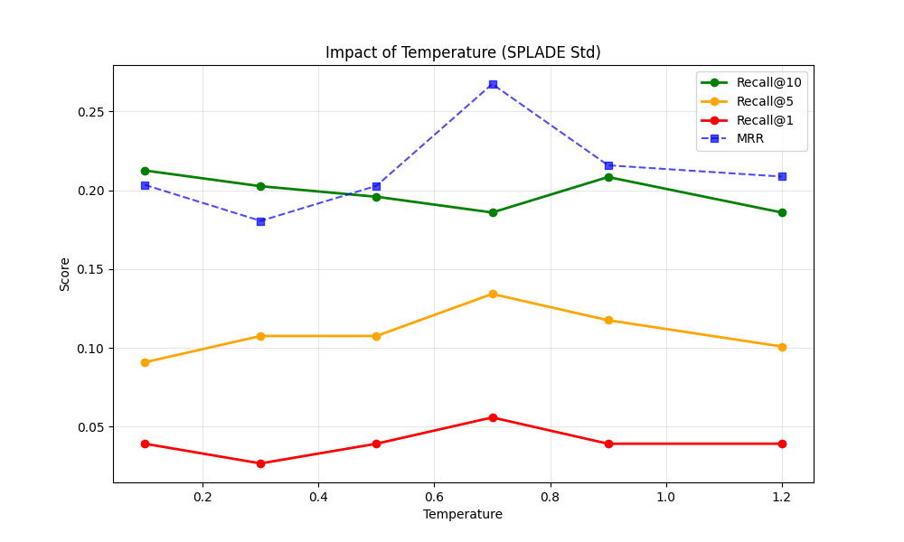

# RAG with SPLADE on LoTTE: sparse retrieval, distillation and LLM query expansion

End-to-end Retrieval-Augmented Generation pipeline on the **LoTTE Technology** dataset (technical Q&A), built around **SPLADE**, a learned sparse retriever. The project compares a lexical baseline, locally trained SPLADE variants and a pretrained SPLADE model, then studies BM25 hybridization and LLM-based query expansion.

## Key results

| Retriever | MRR | Recall@1 | Recall@5 | Recall@10 |
|---|:---:|:---:|:---:|:---:|
| BM25 (baseline) | 0.807 | 0.337 | 0.725 | 0.833 |
| SPLADE trained locally | 0.549 | 0.164 | 0.384 | 0.498 |
| **SPLADE pretrained** (`naver/splade-cocondenser-ensembledistil`) | **0.942** | **0.424** | **0.868** | **0.884** |
| Hybrid BM25 + pretrained SPLADE (best α) | 0.942 | 0.424 | 0.868 | 0.884 |

**Takeaways**

- The pretrained SPLADE model raises MRR from **0.81 to 0.94** over BM25, with Recall@5 going from 0.73 to 0.87.
- BM25 is a very strong baseline on technical vocabulary: SPLADE trained from DistilBERT on a few hundred queries does not beat it.
- **Hybrid fusion brings no gain here**: the best BM25 weight is α = 0 to 0.2, and adding more BM25 steadily degrades MRR down to 0.81.
- In the RAG demo, the pretrained retriever surfaces more precise passages (e.g. code snippets), which directly produces more actionable answers from the generator.



## Pipeline

```
Query ──► [optional] LLM query expansion (SmolLM2-1.7B-Instruct)
      ──► Retriever: BM25 | SPLADE (local / LoRA / distilled / pretrained) | hybrid
      ──► Top-3 passages as context
      ──► Answer generation (SmolLM2-1.7B-Instruct)
```

## What was implemented

- **Data & indexing**: 20k-document LoTTE subset indexed with PyTerrier (BM25); training triplets built with **BM25 hard-negative mining** (lexically close but non-relevant passages).
- **SPLADE from scratch**: DistilBERT MLM head with log-saturated ReLU and max pooling, trained with an in-batch contrastive loss, a hard-negative margin term and **FLOPS regularization** for sparsity.
- **SPLADE + LoRA**: same model with LoRA adapters (r = 16) on the attention query/value projections, via PEFT.
- **Distillation**: SPLADE student trained with an MSE loss on the score margins of a cross-encoder teacher.
- **Hybrid retrieval**: min-max normalized linear fusion `α · BM25 + (1 − α) · SPLADE`, with α swept from 0 to 1.
- **LLM query expansion**: SmolLM2 generates keyword sub-queries that are merged with the original query (weights 1.0 / 0.2), with studies on sampling temperature (0.1 → 1.2) and number of sub-queries (1 → 5).
- **RAG generation**: qualitative comparison of answers produced with the local vs pretrained retriever.

## Other findings

- **LoRA and distillation variants underperformed** (MRR 0.27 for LoRA, below 0.1 for distillation). For distillation, the main cause is that the teacher's scoring head was not trained for relevance (see limitations).
- **Query expansion**: generating a single sub-query worked best; more sub-queries tended to dilute precision without improving recall. Temperature effects were inconsistent, which is expected given sampling noise on a small query set.



## Repository structure

```
.
├── main.py            # full experiment: indexing, training, evaluation, studies, RAG demo
├── config.py          # paths, device, model names
├── data.py            # corpus loading, triplet creation with hard negatives
├── models.py          # SPLADE encoder, cross-encoder teacher, RAG pipeline
├── train.py           # contrastive + FLOPS training, distillation
├── utils.py           # LLM loading, prompting, MRR / Recall@k
├── requirements.txt
└── assets/            # result figures
```

## How to run

```bash
pip install -r requirements.txt   # PyTerrier requires Java 11+
python main.py
```

A GPU is recommended (SPLADE training and SmolLM2-1.7B generation). Model names in `config.py` default to Hugging Face Hub IDs; set `MLM_MODEL_NAME`, `LLM_MODEL_NAME` or `NAVER_MODEL_NAME` to use local copies. Outputs and figures are written to `outputs/`.

## Limitations and next steps

- **Small evaluation set**: metrics are computed on 20 held-out queries, so differences of a few points are not significant. Next step: evaluate on the full LoTTE dev set.
- **Easier-than-real corpus**: the 20k-document subset contains all relevant passages for the selected queries, which inflates absolute scores compared to the full collection.
- **Distillation teachers**: the cross-encoders used as teachers have a freshly initialized scoring head (the MS MARCO model's trained head is not loaded), so the student imitates near-random margins. Loading the teacher with its trained classification head should fix this.
- **Local training budget**: one epoch on ~300 queries is far below what SPLADE needs; more data (e.g. MS MARCO) would be the natural next step.

## Context

Individual project for the *Large Language Models* course, MSc Computer Science – MIND, Sorbonne University (2025–2026). Full report (in French) in `report.pdf`.

**Stack:** Python · PyTorch · Hugging Face Transformers · PEFT · PyTerrier · SPLADE · SmolLM2
